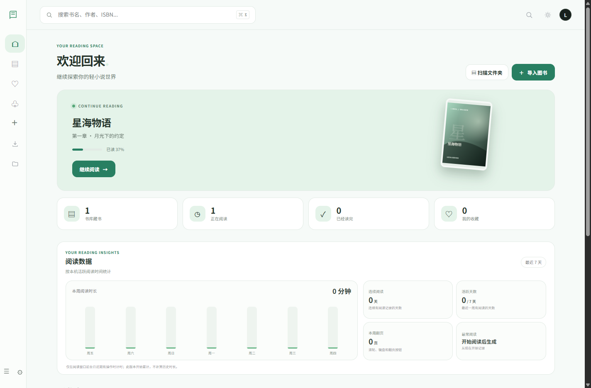
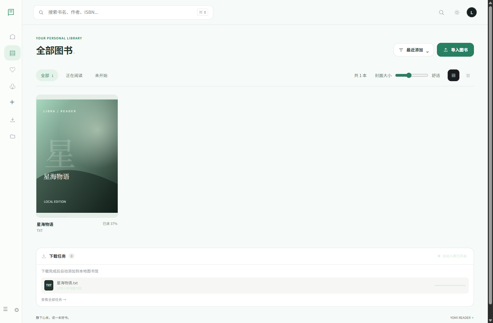

<div align="center">
  
  <h1>Yomi Reader</h1>
  <p>给小说一个安静的阅读空间 · Windows / Android 本地电子书阅读器</p>
  <p><a href="https://github.com/change7488/yomi-reader/actions/workflows/android-apk.yml">查看双端构建</a> · <a href="https://github.com/change7488/yomi-reader/releases">Releases</a> · <a href="CHANGELOG.md">更新日志</a> · <a href="docs/DEVELOPMENT.md">开发指南</a></p>
</div>

Yomi Reader 是一款以 **本地书库、舒适排版、可恢复的阅读进度** 为重点的开源预览版阅读器。Windows 使用 Electron，Android ARM64 使用 Capacitor；两端**共用同一份 HTML/CSS/JavaScript 阅读界面、书库模型、EPUB/TXT 解析与进度管理**，只把文件访问、系统按键等能力放在平台适配层。

## 界面预览

| 首页 | 本地书库 |
| :--: | :--: |
|  |  |

截图为 Windows 版演示书库，Android 采用适配手机的底部导航及沉浸式阅读布局。

## 功能

- **本地格式**：导入 EPUB、TXT、PDF；解析 EPUB 目录与插图，TXT 支持章节规则和编码选项。Windows 与 Android 共用离线 PDF.js 阅读器，支持连续滚动、单页/双页漫画、日漫右向左阅读、缩略图和自动/标准/高清/超清渲染档位。
- **文件夹批量导入**：Windows 和 Android 都可选择目录，递归识别 EPUB / TXT / PDF；格式筛选、默认全选、取消全选、单本勾选。v0.3.1 对大量文件使用分段显示与分批导入，避免一次性占用过多内存。Android 原生扫描最多展示 1,200 个匹配文件，超出时请细分文件夹；单个文件目前限 64 MB。
- **安全去重**：通过 SHA-256 内容指纹跳过已入库文件；默认不重复导入，文件夹导入时可主动允许重复。同一本书的阅读进度不会因再次导入被覆盖。
- **字体库 v0.3.0**：内置 **20 款开源字体风格**（19 款包含中文字符）；支持分类预览、每本书独立选择、设置全局默认，以及从设备导入 TTF / OTF / WOFF / WOFF2 字体。安装后离线可用。
- **阅读体验**：主题、字号、行距、左右留白、滚动/翻页模式、书签、笔记、章节搜索、朗读及阅读记录。PDF 画布采用可视区域附近渲染，并受设备像素预算和活动画布数量限制；PDF 页面数据本身仍由 PDF.js 在内存中读取。
- **桌面阅读工作区**：Windows 将书库与阅读器放在独立窗口中，阅读器支持多书标签、拖动排序、关闭后恢复及最近关闭标签重开。图书、阅读位置与设置仍保存在原来的本地数据库中。
- **进度可恢复**：章节目录、书签和进度条的跳转历史、上一步/下一步及跨次阅读会话记录；正常翻页不会每一页都写入跳转历史。
- **手机操作**：左右区域轻点翻页、中心轻点隐藏工具栏、音量键翻页、系统返回键；阅读时可隐藏系统状态栏和导航栏，离开阅读器后恢复。
- **本机使用**：不需要创建账号。当前没有跨设备自动同步；书籍、字体和阅读记录不会被主动上传。

## 安装与下载

### Windows x64

从 [v0.3.1 预览版 Release](https://github.com/change7488/yomi-reader/releases/tag/v0.3.1) 下载 `Yomi-Reader-0.3.1-x64-Setup.exe`。旧版 v0.2.3 仍保留在 Releases，不会被覆盖。Windows 安装包目前尚未进行商业代码签名。

### Android ARM64

从 [v0.3.1 预览版 Release](https://github.com/change7488/yomi-reader/releases/tag/v0.3.1) 下载修复文件夹导入闪退的 `Yomi-Reader-Android-arm64-debug.apk`，在 Android ARM64 手机上安装。如需查看构建详情，可访问 [GitHub Actions](https://github.com/change7488/yomi-reader/actions/workflows/android-apk.yml)。Release 同时附有 `SHA256SUMS.txt` 供校验安装包。

**提醒**：目前 APK 为自动构建的 debug 签名测试版，不是正式签名应用。不同构建间签名可能不一致，不能保证覆盖安装。卸载应用可能清除本机书库、阅读进度与自定义字体，因此请勿在未备份数据前卸载旧版。正式稳定更新仍需配置固定的发布签名。

## 字体：20 款已内置，支持导入

在 **阅读器 → 排版 → 阅读字体** 中可以预览和切换字体；在 **偏好设置 → 阅读字体** 中也可以导入或设置默认字体。

默认字体包包括：思源黑体（常规/粗/特粗）、思源宋体（常规/粗/特粗）、朱雀仿宋、霞鹜文楷、得意黑、抖音美好体、未来荧黑、站酷庆科黄油体、站酷快乐体、江城圆体、猫啃什锦黑、铁蒺藜体、马善政楷书、志莽行书、缝合像素字体，以及 Cormorant Garamond 西文字体。

内置字体均来自具有 OFL-1.1 授权信息的 [Qiaomu Cover Fonts](https://github.com/joeseesun/qiaomu-cover-fonts) v1.0.0 字体集合；源文件按 SHA-256 校验，构建时自动下载并将相应许可证一并打包。为控制包大小，中文字体采用了原提供方的字符子集；遇到未覆盖的字形时会自动回退到系统字体。所有字体的版权属于各自作者，详情见 `ui-prototype/fonts/licenses/`（构建产物中）和 `ui-prototype/fonts/catalog.json`。

自定义字体只保存在当前设备的 IndexedDB 中，单文件限制 16 MB，最多 40 款；删除字体不删除你的书籍。

## 从源码运行

需要 Node.js 22+。初次运行需要联网下载约 30 MB 的已校验字体，之后可离线启动；字体二进制文件按工程规范不提交进 Git。

```powershell
git clone https://github.com/change7488/yomi-reader.git
cd yomi-reader
npm ci
npm run fonts:sync
npm run pdfjs:sync
npm run check
npm start
```

`npm start`、`npm run test:ui` 和 Windows 打包会自动同步 PDF.js 运行文件。首次同步需要 `npm install` 已安装根项目依赖；PDF.js 运行文件由固定版本 `pdfjs-dist` 提供，不需要 Android 依赖安装步骤。

打包 Windows：

```powershell
npm run dist:win
```

打包 Android ARM64（另外需要 JDK 21 和 Android SDK 36）：

```powershell
npm run android:apk
```

以上构建都会准备离线字体资源。详细结构、平台限制及开发约定见 [docs/DEVELOPMENT.md](docs/DEVELOPMENT.md)。

## 项目结构

```text
ui-prototype/
  app.js                 应用入口
  reader/                共享阅读控制器 / EPUB TXT / 进度服务
  fonts/                 字体管理、20 款清单、授权与离线资源
  library/               书库视图
  storage/               IndexedDB 迁移与访问
  platform/              Android 文件导入、手机布局与共享 PDF.js 阅读器
  onboarding/            新手教程
  styles/                分模块 CSS
electron/                Windows 桌面原生壳
mobile/                  Android Capacitor 壳与原生桥接
scripts/                 字体/PDF.js 同步、Android 构建与图标配置
docs/                    开发文档
```

**兼容性**：为保留老用户书库，Windows 内部数据库名称和 Electron appId 沿用早期 Libra Reader 标识，外观与产品名称统一为 Yomi Reader；不会为了修改品牌而自动迁移或删除用户数据。

## 测试、许可证与反馈

```powershell
npm run check
npm run test:ui
```

阅读器源码使用 [MIT License](LICENSE)。第三方字体、Electron/Capacitor 及其他依赖遵循各自许可。项目不提供受版权保护的书籍。欢迎在 [Issues](https://github.com/change7488/yomi-reader/issues) 反馈兼容性问题或功能建议。
